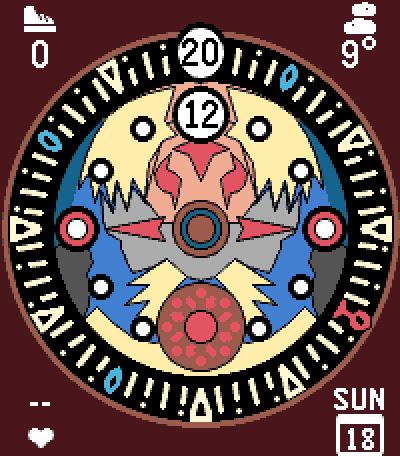
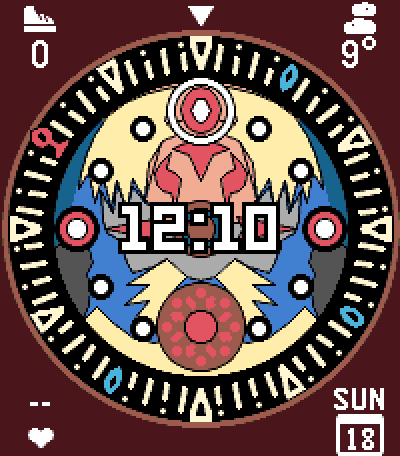
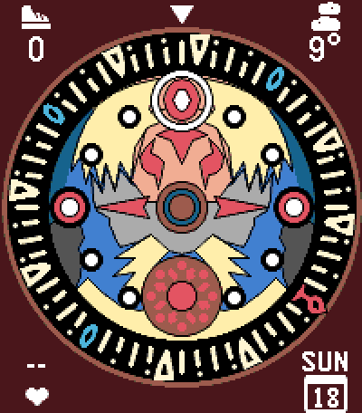

# Clock Town Clock

Pebble Time 2 watch face inspired by the Clock Tower design from The Legend
of Zelda - Majora's Mask. Supports displaying the time in digital format and
the four corners are configurable to display current date, weather, steps and
heart rate.

| Default | Digital time in the centre | Digital time hidden |
| :---: | :---: | :---: |
|  |  |  |

## How to read it

Like the clock in the game, the outer minute ring and the inner hour disc both
turn counter-clockwise; the current minute and hour are the marks at the top.
The ring rocks back and forth for a moment before it moves on to the next
minute. Between sunset and sunrise the sun on the hour disc becomes a moon.

## Settings

Open the watch face's settings in the Pebble app to change:

- **Digital time**: on the ring and disc (default), in the centre, at the
  bottom of the screen, or hidden
- **12-hour format**: off by default (24-hour)
- **Corners**: weather, date, steps, heart rate or nothing, for each corner
- **Background colour**: corner text and icons switch to black on light
  colours

## Build and install

Requires the [Pebble SDK](https://developer.repebble.com/sdk) and Node.js.

```bash
npm install
pebble build
pebble install --emulator emery     # or --cloudpebble for your watch
```

Only the emery platform (Pebble Time 2) is supported.

## Data sources

- Weather, sunrise and sunset come from [Open-Meteo](https://open-meteo.com)
  (no API key needed), fetched by the phone every 30 minutes using your
  location.
- Steps and heart rate come from Pebble Health on the watch.
- The weather icons are the official Pebble timeline weather icons, converted
  by `tools/weather_icons.py`.

## License

The watch face code is released under the [MIT License](LICENSE). The
following parts keep their own terms:

- `.agents/skills/pebble-watchface/`: the
  [pebble-watchface agent skill](https://github.com/coredevices/pebble-watchface-agent-skill)
  by Core Devices
- `resources/images/weather_*.png`: derived from the Pebble timeline weather
  icons

## Disclaimer

This is an unofficial fan project. The Legend of Zelda and Majora's Mask are
trademarks of Nintendo. This project is not affiliated with or endorsed by
Nintendo.
